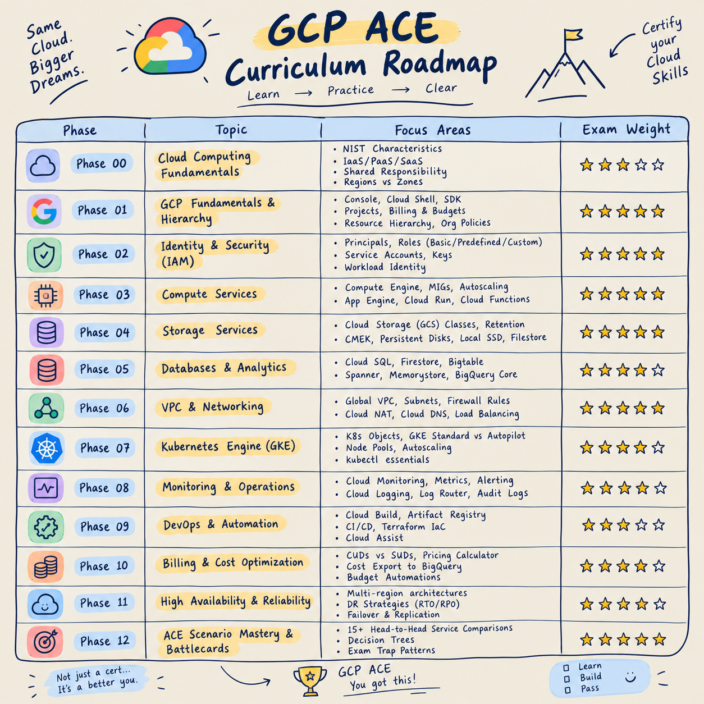

# Google Cloud Associate Cloud Engineer (ACE) Master Playbook

> **The definitive, zero-fluff, exam-ready handbook and question bank designed to take you from beginner to Google Cloud Certified Associate Cloud Engineer.**

[](https://cloud.google.com/learn/certification/associate-cloud-engineer)
[](LICENSE)
[-blue.svg)](#curriculum-roadmap)
[](#practice-question-bank)

---

## About This Playbook

This repository is an all-in-one preparation system for the **Google Cloud Associate Cloud Engineer (ACE)** exam. 

Unlike conventional study guides that either provide high-level summaries or overwhelming reference docs, this playbook is built on a **standardized blueprint per chapter**. Every service is broken down from ground zero using clear, concise, human-written English notes, architecture diagrams, hands-on CLI (`gcloud`) walkthroughs, and exam trap breakdowns.

### Official Exam Alignment
- Official Guide: [Google Cloud Associate Cloud Engineer Exam Guide](https://cloud.google.com/learn/certification/guides/associate-cloud-engineer)
- Exam Duration: 2 Hours (50–60 Multiple Choice / Multiple Select Questions)
- Passing Score: Scaled (Google does not publish exact pass mark; target **80%+** on mocks)

---

## Who Is This Playbook For?

This playbook is designed to be accessible and valuable for anyone learning or working with Google Cloud Platform (GCP):

- **Absolute Beginners:** If you are starting from ground zero, Phase 00 and Phase 01 walk you through core concepts in plain English without overwhelming jargon.
- **Engineers Wanting to Advance Their Skills:** If you already use cloud services and want to deepen your understanding, master the `gcloud` CLI, and study real-world production architectures.
- **Certification Aspirants:** If you are preparing for Google Cloud certifications (such as the Associate Cloud Engineer - ACE exam or preparing for Professional Cloud Architect), with 300+ scenario-based questions, exam trap tables, and timed mock tests.
- **Teams and Practitioners:** If you need a clean, structured, zero-fluff daily reference for GCP service limits, configuration defaults, and architectural trade-offs.

---

## How To Use This Playbook (The 4-Step Strategy)

```
┌─────────────────┐       ┌─────────────────┐       ┌─────────────────┐       ┌───────────────────┐
│  Step 1: Read   │  --> │  Step 2: Drill  │  -->  │  Step 3: Mock   │  --> │   Step 4: Drill   │
│   Core Phase    │       │ Phase Questions │       │    Exam Run     │       │  High-Frequency   │
│ (Theory + CLI)  │       │   (Immediate)   │       │ (Every 3 Phases)│       │  Repeated Traps   │
└─────────────────┘       └─────────────────┘       └─────────────────┘       └───────────────────┘
```

1. **Step 1 - Master the Phase (`phases/`):** Study the phase file sequentially. Every file contains 21 standard sections including architecture, CLI syntax, and quick revision sheets.
2. **Step 2 - Drill Phase Questions (`practice-questions/by-phase/`):** After reading the theory, immediately test your retention with the dedicated 15-question drill (10 MCQs + 5 MSQs) with deep option explanations.
3. **Step 3 - Take Mock Exams (`practice-questions/mock-exams/`):** Every 3–4 phases, run a timed 50-question mock exam to practice time management across mixed GCP domains.
4. **Step 4 - Final Polish with High-Frequency Bank (`practice-questions/high-frequency-questions.md`):** In the last 72 hours before your exam, drill the repeated questions and trap scenarios that candidates encounter year after year.

---
## Curriculum Roadmap

<p align="center">
  
</p>

### Quick Phase Navigation

| Phase | Topic | Link |
| :--- | :--- | :---: |
| **Phase 00** | Cloud Computing Fundamentals | [Study Phase 00 ->](phases/phase-00-cloud-fundamentals.md) |
| **Phase 01** | GCP Fundamentals & Hierarchy | [Study Phase 01 ->](phases/phase-01-gcp-fundamentals.md) |
| **Phase 02** | Identity & Security (IAM) | [Study Phase 02 ->](phases/phase-02-identity-security-iam.md) |
| **Phase 03** | Compute Services | [Study Phase 03 ->](phases/phase-03-compute.md) |
| **Phase 04** | Storage Services | [Study Phase 04 ->](phases/phase-04-storage.md) |
| **Phase 05** | Databases & Analytics | [Study Phase 05 ->](phases/phase-05-databases.md) |
| **Phase 06** | VPC & Networking | [Study Phase 06 ->](phases/phase-06-networking.md) |
| **Phase 07** | Kubernetes Engine (GKE) | [Study Phase 07 ->](phases/phase-07-kubernetes-gke.md) |
| **Phase 08** | Monitoring & Operations | [Study Phase 08 ->](phases/phase-08-monitoring-operations.md) |
| **Phase 09** | DevOps & Automation | [Study Phase 09 ->](phases/phase-09-devops-automation.md) |
| **Phase 10** | Billing & Cost Optimization | [Study Phase 10 ->](phases/phase-10-billing-cost-optimization.md) |
| **Phase 11** | High Availability & Reliability | [Study Phase 11 ->](phases/phase-11-high-availability-reliability.md) |
| **Phase 12** | ACE Scenario Mastery & Battlecards | [Study Phase 12 ->](phases/phase-12-scenario-mastery.md) |

---
## Standard Chapter Structure (The 21-Section Blueprint)

Every phase guide adheres to an uncompromising, consistent structure:

```
1. Definition (Clear, Plain English Definition)
2. Why does this service exist? (Problem it solves)
3. Architecture / Working (Internals, lifecycle, ASCII diagrams)
4. Core Components (What, why, how, analogies)
5. Key Features (Feature-by-feature breakdown)
6. Types / Variants (Comparison tables & taxonomies)
7. Configuration & Important Settings (Defaults & choices)
8. Pricing & Cost Considerations (Billing model & traps)
9. Security Considerations (IAM permissions, least privilege)
10. Advantages (Practical industry benefits)
11. Limitations (When NOT to use)
12. Real-World Use Cases (10+ industry scenarios)
13. Hands-on (Step-by-step Console + gcloud CLI commands)
14. ACE Exam Focus (Exam Weight: 5/5) (Keywords, traps, common scenarios)
15. Service Comparisons (Direct head-to-head comparison tables)
16. Best Practices (Official Google Cloud recommendations)
17. Common Mistakes (Beginner pitfalls to avoid)
18. Quick Revision Sheet (1-page high-density summary & mnemonics)
19. Interview Questions (Top 10 technical Q&As)
20. ACE Practice Questions (10 MCQs + 5 MSQs with deep explanations)
21. Related Topics (Prerequisites, next steps, exam domain mappings)
```

---

## Repository Directory Layout

```
gcp-playbook/
├── README.md                          <- Main landing page, roadmap, study guide
├── CONTRIBUTING.md                    <- Contribution guidelines for question submissions
├── phases/                            <- Core comprehensive notes (Phases 00 to 12)
│   ├── phase-00-cloud-fundamentals.md
│   ├── phase-01-gcp-fundamentals.md
│   ├── phase-02-identity-security-iam.md
│   ├── phase-03-compute.md
│   ├── phase-04-storage.md
│   ├── phase-05-databases.md
│   ├── phase-06-networking.md
│   ├── phase-07-kubernetes-gke.md
│   ├── phase-08-monitoring-operations.md
│   ├── phase-09-devops-automation.md
│   ├── phase-10-billing-cost-optimization.md
│   ├── phase-11-high-availability-reliability.md
│   └── phase-12-scenario-mastery.md
├── practice-questions/                <- Dedicated question drill banks
│   ├── by-phase/                      <- 15-question sets for immediate post-phase testing (Phases 00–12)
│   │   ├── phase-00.md
│   │   ├── phase-01.md
│   │   └── ... (phase-02 to 12)
│   ├── top-100-master-questions.md    <- Instructor Top 100 Master Questions categorized across 6 domains
│   ├── mock-exams/                    <- Full-length 50-question timed exam simulators (100 questions)
│   │   ├── mock-exam-01.md            <- Mock 01 (includes actual exam recall questions)
│   │   └── mock-exam-02.md            <- Mock 02 (full mixed-domain timed simulator)
│   └── high-frequency-questions.md    <- Gold repeated exam questions & top traps
└── assets/
    └── diagrams/                      <- Architecture visual references
```

---

## Practice Question Bank (300+ Exam Questions)

- **[Phase-by-Phase Practice Drills](practice-questions/by-phase/):** 195 interactive questions (15 per phase across all 13 phases) with deep distractor rationales and score tracking.
- **[Top 100 Topic-Wise Master Questions](practice-questions/top-100-master-questions.md):** The definitive 100-question master collection from the lead GCP instructor across all 6 core exam domains.
- **[Full-Length Mock Exam 01](practice-questions/mock-exams/mock-exam-01.md):** 50-Question timed full simulator featuring latest real exam test recall scenarios.
- **[Full-Length Mock Exam 02](practice-questions/mock-exams/mock-exam-02.md):** 50-Question timed full simulator covering advanced edge-cases and troubleshooting.
- **[High-Frequency Exam Traps](practice-questions/high-frequency-questions.md):** Recurring scenario patterns, traps, and gotchas reported in recent test cycles.

---

## Contributing

Have you taken the ACE exam recently? Found a recurring question pattern or want to submit an improvement?
Check out our [CONTRIBUTING.md](CONTRIBUTING.md) guide!

### Diagram Modernization Initiative (Call for Contributions)

We want to upgrade every text and ASCII diagram throughout this playbook with high-quality visual pictures or interactive Mermaid diagrams.

If you would like to help create visual architecture diagrams or convert text flows into Mermaid syntax, your contributions are warmly welcomed! Please feel free to open an issue or submit a pull request with new diagrams for any phase or section.

---

## Sources & Reference Attribution

All practice questions, scenario breakdowns, and architectural insights in this playbook have been meticulously synthesized, cross-verified, and aligned with authoritative, valid sources:

- **Google Cloud Official Documentation & Architecture Framework:** Command-line syntax (`gcloud`, `gsutil`, `bq`), Google-recommended security benchmarks, IAM hierarchy models, quota structures, and official deployment patterns.
- **Google Cloud Associate Cloud Engineer Official Exam Guide:** Official syllabus breakdown, exam domain weights, and Google sample exam questions.
- **Real Candidate Exam Debriefs & Verified Test Recalls:** Practical scenarios and problem formulations verified from recent test cycles, reflecting current exam focus areas (e.g., GKE Autopilot vs Standard, VPC Service Controls, Cloud Run ingress controls, IAM Conditions, Cost Optimization).
- **Curated Cloud Engineer Interview Preparation Banks:** High-yield technical screening questions, incident management scenarios, and cloud architecture interview problem sets available across reputable engineering prep resources.
- **Google Cloud Skills Boost & Qwiklabs:** Hands-on lab architectures, enterprise network topologies, step-by-step CLI workflows, and configuration defaults.
- **Top 100 Lead Instructor Question Bank:** Curated master drills categorized across all 6 official exam domains with detailed distractor rationale.

Every question has been checked to eliminate duplicates across the Mock Exams and the Top 100 Master Bank, ensuring an expansive, non-redundant training experience.

---

## Feedback, Corrections & Community Reporting

Accuracy and clarity are our top priorities. If you notice:
- Any typo, grammatical error, or formatting glitch
- A factual mistake or outdated Google Cloud command/setting
- A missing critical exam topic or scenario that should be covered
- Additional examples or explanations that could make a concept clearer

Please don't hesitate to reach out! You are highly encouraged to:
- **Open an Issue** on this GitHub repository, or
- **Connect directly via Email:** [amansingh080704@gmail.com](mailto:amansingh080704@gmail.com)

Every contribution helps keep this playbook 100% exam-ready for fellow cloud engineers.

---

## License & Fair Use Policy

This repository is protected and licensed under the **[Creative Commons Attribution-NonCommercial-ShareAlike 4.0 International License (CC BY-NC-SA 4.0)](LICENSE)**.

- **Permitted:** Free for personal study, student groups, self-preparation, and non-commercial educational sharing with full attribution.
- **Strictly Prohibited:** Commercial reselling, paywalling, course bundling, or forking and stripping credits to rebrand and claim as your own creation. Attribution to Aman Singh and a link to the original repository are strictly required. See [LICENSE](LICENSE) for full legal terms.
